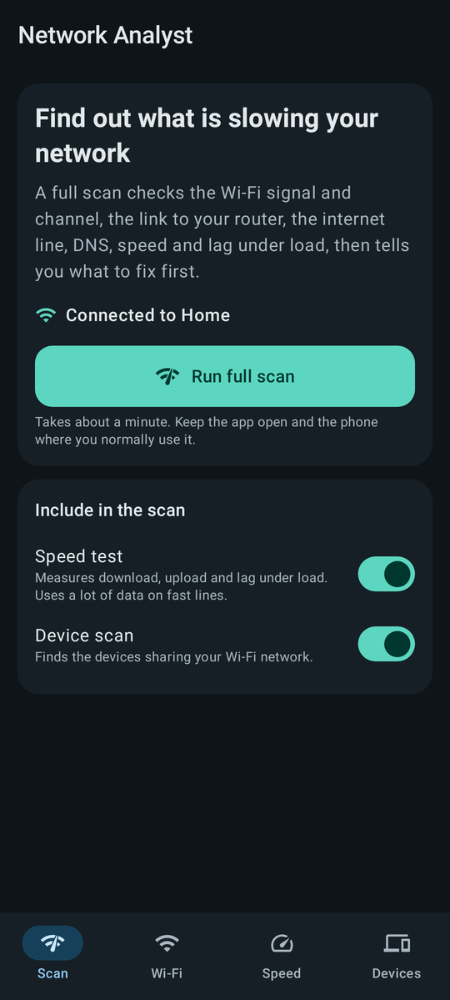
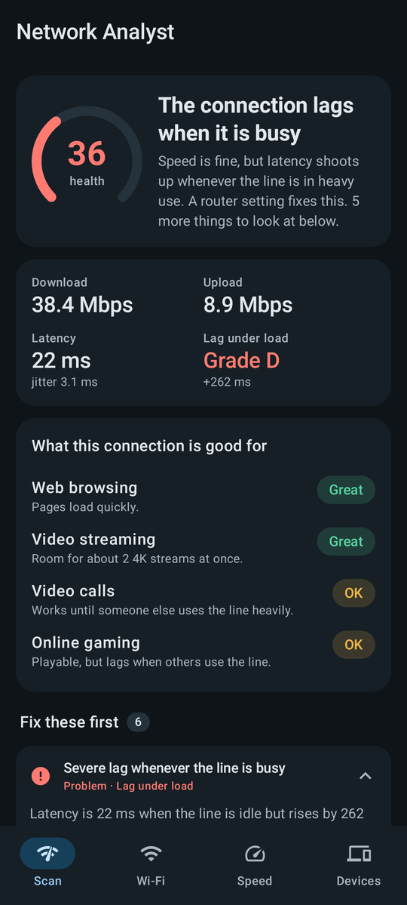
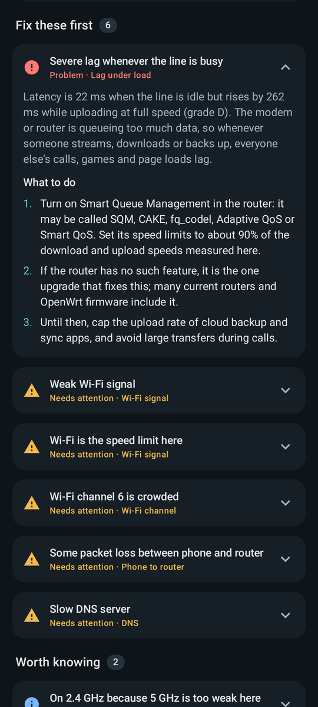
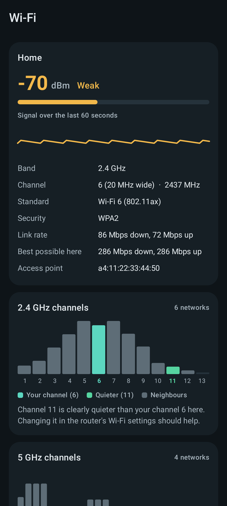
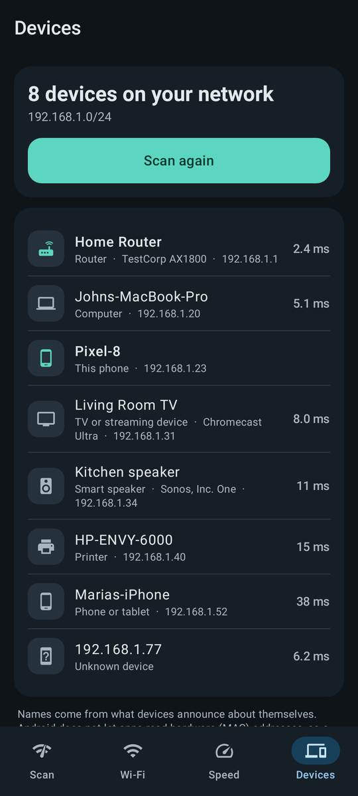

# Network Analyst

An Android app that works out why a network feels slow and says what to fix first.

A full scan takes about a minute. It measures the Wi-Fi link, the hop to the router, the
internet line, DNS, speed and lag under load, then separates "the Wi-Fi is the weak point"
from "the internet line is the weak point" and lists concrete fixes with the measurement
behind each one.

<p>
  
  
  
  
  
</p>

> **Status:** everything here builds, passes its tests and has been checked against real
> servers and real protocol implementations (see [docs/VERIFICATION.md](docs/VERIFICATION.md)),
> but it has **not yet been run on a physical phone**. The screenshots are rendered from
> sample data. Expect to find device-specific rough edges on first use.

## What it checks

| Area | What is measured | Examples of what it reports |
| --- | --- | --- |
| Wi-Fi signal | Signal strength over several seconds, link rate, band, standard, channel width, security | Weak or fluctuating signal, stuck on a far-away access point, on 2.4 GHz while 5 GHz is in range, outdated standard, WEP/TKIP capping the link at 54 Mbps, 40 MHz channel on 2.4 GHz |
| Wi-Fi channel | Every network in range and the spectrum each occupies | Crowded channel with a quieter one to switch to, router on an overlapping channel, band busy everywhere |
| Phone to router | 40 pings to the default gateway | Packet loss, slow or uneven response inside the home |
| Internet line | Pings to two public anchors, compared with the router hop | Loss or latency beyond the router, i.e. modem, line or provider |
| DNS | Real lookups timed against the network's resolver and four public ones | Slow, failing or dead DNS server, and a faster alternative |
| Speed | Download and upload over parallel connections | Slow speeds, slower than usual for this network, Wi-Fi link acting as the ceiling |
| Lag under load | Latency while the line is saturated in each direction | Bufferbloat grade A+ to F and the router setting that fixes it |
| Router | UPnP queries to the gateway, first hops of the path | Double NAT, carrier-grade NAT, internet port stuck at 100 Mbps, other devices using the line right now |
| Devices | Every device on the subnet, named where it announces itself | How many devices share the network and what they are |

The report ends with a 0 to 100 health score and a verdict for browsing, streaming, video
calls and gaming. It can be shared as plain text, for example with a provider's support.

Three more tabs give direct access to the Wi-Fi analyser (live signal, per-channel
congestion chart, nearby networks), the speed test with history, and the device list.

## Install

Build it (below) or download the APK from the **Build** workflow run of the latest commit
under the repository's Actions tab, then open the file on the phone and allow installation
from that source. Requires Android 8.0 or newer.

`app-release.apk` is the one to install. It is signed with a throwaway debug key, which is
fine for your own phone; an APK built on a different machine has a different key, so
uninstall the old one before installing it.

## Build

Requirements: JDK 17 or newer, and the Android SDK with platform `android-37.2` and
build-tools `36.0.0`. Point `ANDROID_HOME` at the SDK or put `sdk.dir=...` in
`local.properties`.

```sh
./gradlew :app:assembleRelease        # app/build/outputs/apk/release/app-release.apk
./gradlew :core:test :app:testDebugUnitTest :app:lintDebug
```

Toolchain: Android Gradle Plugin 9.5, Kotlin 2.4, Gradle 9.6, Jetpack Compose (Material 3),
compile and target SDK 37 (Android 17), minimum SDK 26.

## Permissions

| Permission | Why |
| --- | --- |
| Location (precise) | Android only shows nearby Wi-Fi networks, and the name of the connected one, to apps holding it. Used for the channel analysis. Location itself is never read. |
| Nearby devices / local network (Android 17+) | Android 17 blocks all traffic to the local network without it: pinging the router, querying it, finding devices. |
| Wi-Fi state, change Wi-Fi state | Reading the link and asking for a fresh scan. |
| Wake lock | Holding the low-latency Wi-Fi mode during latency tests, so the phone's own power saving is not mistaken for a slow network. |
| Internet, network state | The tests themselves. |

Every permission is optional. Without location the channel analysis is skipped; without
local network access only the internet side is tested. The report says what was skipped.

## Privacy

There is no account, no analytics and no server of its own. Test history is stored on the
phone and excluded from backups. The app talks to:

- **Cloudflare's speed test endpoints** (`speed.cloudflare.com`) for the speed test. Cloudflare
  sees your public IP address, as any speed test service does.
- **Public DNS resolvers** (Cloudflare, Google, Quad9, OpenDNS) and the anchors `1.1.1.1` and
  `8.8.8.8`, with a handful of lookups for well-known site names and ICMP pings.
- **Devices on your own network**, to find and identify them.

## Things worth knowing

- **Data use.** A speed test on a fast line moves a lot of data: several hundred megabytes on
  a 500 Mbps connection. The test ends early once the rate has settled, and on metered
  connections each direction stops after 100 MB.
- **The analysis is rule-based.** Thresholds such as "-67 dBm is the floor for reliable
  real-time traffic" are common practice, not standards, and the channel congestion score is
  a heuristic: a phone can see other networks' beacons but not how much traffic they carry,
  nor non-Wi-Fi interference. Each finding states the measurement it is based on.
- **Packet loss resolution.** Loss is judged from 40 probes, and a single missing reply is
  ignored, so loss below about 5% is not detected.
- **No hardware addresses.** Android does not let apps read the ARP table, so devices are
  named from what they announce (mDNS, UPnP, NetBIOS, reverse DNS). A device that announces
  nothing shows only its IP address.
- **Wi-Fi scans are rationed.** Android allows four scans per two minutes; beyond that the
  app shows the system's latest results.
- **Router details depend on UPnP.** Double NAT detection, WAN link rate and "other devices
  are using the line" need a router with UPnP enabled. The path check additionally needs the
  system `ping` program.

## Layout

```
core/   Pure Kotlin, no Android. Measurement engines and analysis, tested on the JVM.
  speed/       Speed test (parallel streams, server-confirmed upload accounting, latency under load)
  dns/         DNS wire format and resolver benchmark
  ping/        ICMP echo packets, parser for ping command output
  wifi/        Channel maths, congestion scoring, security parsing
  discovery/   SSDP, UPnP gateway queries, mDNS, NetBIOS, LAN scanner, device classification
  analysis/    Rules that turn measurements into findings, score and verdicts
  history/     Stored results and the "usual speed" baseline
app/    Android. Collectors, scan coordinator, Compose UI.
  data/        Connectivity and Wi-Fi collectors, ICMP pinger with fallbacks, scan coordinator
  ui/          Scan, Wi-Fi, Speed and Devices screens
```

## Tests

```sh
./gradlew :core:test                                   # engines and analysis
./gradlew :app:testDebugUnitTest                       # app logic, launch smoke test
./gradlew :app:recordRoborazziDebug                    # renders every screen to app/build/screenshots
./gradlew :core:test -PliveTests --tests '*LiveNetworkTest*'   # real speed test and DNS, uses the network
```

How each part was verified, and what has not been, is in
[docs/VERIFICATION.md](docs/VERIFICATION.md).
